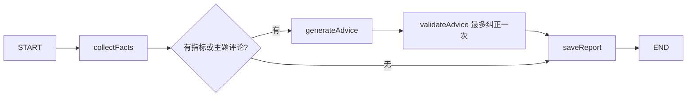

# 运营复盘接口与数据口径

## 输入与保存

`POST /api/metrics/reviews` 使用当前登录用户的 Cookie/CSRF，JSON 为：

```json
{
  "accountId": "本人内部账号 UUID",
  "topic": "线程池",
  "from": "2026-10-10T00:00:00Z",
  "to": "2026-10-11T00:00:00Z",
  "requestId": "本次请求的 UUID"
}
```

观测窗口是 UTC `[from,to)`，最长 31 天，最多 6 位小数秒。topic 为去除两端空白后的 1～100 字关键词。UUID 使用标准完整格式，大小写归一化。复盘按账号读取窗口内最多 20 个“作品 + 来源”组合；超过时保存失败 `REVIEW_SCOPE_TOO_LARGE`，要求缩小范围，模型不调用。每个来源最多使用窗口内最近 1000 个快照，保留截断标记、首个观测时间和实际返回数量。

`requestId` 按用户唯一。同一用户、同一请求与参数返回同一报告，不再次调用模型；相同 ID 改参数返回 409 `REVIEW_REQUEST_CONFLICT`。想纳入后续新导入数据，应明确生成一个新请求。身份由后端固定，不接受客户端指定 ownerId。

生成/复用报告返回 201，需检查报告 `status`；非法请求 400、无权账号 404、匿名 401、缺 CSRF 403。`GET /api/metrics/reviews/{id}` 只读本人报告，其他用户返回 404。`GET /api/metrics/reviews?accountId=...` 返回本人该账号最近 20 份报告。

V7.1 的 `operation_reviews` 保存请求、事实快照、校验后的建议、状态、尝试次数和固定错误码。事实在模型调用前独立保存；报告复用时不会重新读取最新资料并替换旧依据。网络调用期间不持有报告预约事务或账号行锁。

## 链路



LangGraph4j 状态 DTO 支持默认序列化复制。报告状态和事实快照由应用存入 MySQL；本日没有配置框架原生 checkpoint，也没有自动续跑未知模型调用。

| status | 含义 |
| --- | --- |
| RUNNING | 已预约请求，正在采集事实 |
| GENERATING | 已保存事实，开始模型尝试或纠正 |
| SUCCEEDED | 模型输出通过结构和引用校验，报告保存 |
| INSUFFICIENT_DATA | 当前范围没有指标或主题匹配评论，跳过模型，建议数组为空 |
| FAILED | 请求范围过大、模型未配置/认证/预算明确拒绝，或两次输出仍无效 |
| NEEDS_REVIEW | 超时、上游故障或内部过程结果不明，需要核对，不能自动重发 |

模型正常调用 1 次；结构或引用不合法、已完成的响应为空时最多明确纠正 1 次。整个输出必须是单个 JSON 对象，尾随第二个对象或文字也拒绝。模型通过既有 ModelGateway 使用报告 ID 记账并执行额度检查；attempts 是流程尝试次数，实际供应商调用以用量账本为准。超时/上游失败不进入纠正。同一请求对任何状态均只复用已有记录；普通手动请求中途退出可能留下 RUNNING/GENERATING，不自动重发。W7-D6 新增定时复盘与其周期恢复，见下文；没有复盘通知发送。

## 报告字段

报告含 `id,accountId,status,request,facts,advice,attempts,errorCode,createdAt`。

- `facts.account`：生成时的名称、受众、定位、栏目和周目标。
- `facts.from/to/dataUpdatedAt`：请求窗口与实际引用的最新指标/评论采集时间；不是服务器现在时间，也不包含所有未匹配评论。
- `facts.metrics`：每个作品/来源的 `metric:N` 引用、作品标识、来源、观测数/截断标记、首次时间、previous/latest 两个最近观测。数字由后端计算，十进制字符串避免浏览器丢失 BIGINT 精度。
- `facts.evidence`：窗口内该关键词匹配的最多 20 条评论，以及已有参考资料。评论保留来源和时间；参考资料可以早于观测窗口，保留原链接/文件与资料 ID。
- `facts.publications`：实际匹配的原计划 ID、计划项 ID、选题/脚本 ID、作品、链接和登记时间。
- `facts.limitations`：确定性的缺失、单个快照、下降、窗口限制及未关联计划说明。
- `advice.hypotheses`：模型提出的可能解释，附 `evidenceIds`，不能当作已证实因果。
- `advice.experiments`：尚未执行的候选选题、动作、如何测量及对应引用。

变化量只比较窗口内最后一个快照与其相邻前一个，不是整个窗口累计变化、自然日新增或增长率。首条未知、不跨缺失点补算；缺少指标保持 null，播放为零时比例 null。来源之间不合并。报告仅保存最近两条数值与窗口摘要，完整最近观测序列仍使用趋势接口读取。

发布关联要求同一 owner/account，且外部作品 ID 大小写与前导零完全匹配。URL 未解析为 ID；只有 URL 没有 ID 的发布记录不猜测关联。一个作品如匹配多个已登记计划项，全部保留；最多 100 个关联，超过则拒绝扩大复盘范围。publishedAt 是站内登记发布时间，不能冒充平台 API 核实的时间。

模型根 JSON 只允许 hypotheses/experiments；不能增加 facts 或写回指标。假设必须引用本次实际提供的 metric/comment；实验还可引用 account/material。引用白名单、字段、长度和数量会校验，编造引用或额外事实字段不保存为成功。自然语言解释仍是待验证的模型建议，格式和引用通过不等于语义真实性已核实。

指标/评论不足时不推测平台表现或同行完整数据。没有匹配评论不意味着观众没有该需求。参考资料中的数字属于用户提供的陈述，不自动当作平台事实。本轮测试使用隔离库和本地模型 HTTP 替身，真实供应商与运营效果另行验收。

## 工作台手动复盘（W7-D6 页面部分）

“作品观测”区域的“复盘与选题实验”提供关键词与本地时间窗口输入、显式创建按钮、最近 20 份历史报告以及只读刷新。报告分别展示事实、评论/资料来源、发布关联、口径限制、未证实的可能解释和未执行实验；引用链接跳到本报告对应依据。表格在手机内部滚动，外链仅允许 HTTP/HTTPS，评论和模型文字以纯文本显示。

发送前将完整请求及 UUID 写入当前标签页 sessionStorage，账号切换或页面刷新后恢复未确认请求；存储失败阻止发送。网络超时或不完整成功响应保留原编号与参数，用户只能复用该请求查询；RUNNING/GENERATING 也保留编号，不开启第二个意图。后端明确 400/404/409 拒绝时释放参数以便修改；其他不明确失败继续复用。终态合法响应清理本地请求。浏览器存储被人为删除、标签页关闭后不保证恢复客户端意图，应先查看已保存报告和用量。

W7-D6 已用单独 DEMO 账号验证真实 CSV 接口与一次 DeepSeek 手动复盘，详见 [页面验收](qa/2026-10-11-w7-data-ui.md)。这验证接入和链路，不表示导入样例是实际抖音数据。定时复盘另有独立配置与周期记录，复用同一报告服务。

## 每周定时复盘与恢复

`GET/PUT /api/metrics/review-jobs/accounts/{accountId}` 使用本人 Cookie/CSRF，返回 `{schedulerEnabled,job,triggers}`。没有配置时 `job=null,triggers=[]`，无权账号 404、匿名 401、PUT 缺 CSRF 403；非法设置 400 `INVALID_REVIEW_JOB`。输入为 `dayOfWeek`（周一 1～周日 7）、`localTime`（整分钟）、`timeZone`（Java ZoneId 支持的时区）、`enabled` 和 `topic`（去两端空白 1～100 字）。每个账号只有一个配置，更新保留 job.id 和既有执行记录；保存不显式调用模型，但已开启服务器扫描时，新启用的到期任务可被后续扫描领取。

V7.2 保存 `review_jobs` 与 `review_job_triggers`。触发记录在调用前事务提交，保留当前关键词、账号、UTC 窗口和 UUID。按 job.id + 当地周一日期唯一，重复/并发扫描只领取一次；编辑配置不改写该周期请求，失败也不重领。当地周归属由当前配置时区决定，修改时区可能改变边界，不按滚动 168 小时去重。

服务器每 60 秒检查；仅在配置星期当天、计划时刻之后执行，当天一直离线则不补跑旧日期。窗口是 `[计划本地时刻.minusDays(7),计划本地时刻)` 转 UTC；扫描晚到不延长窗口。夏令时会让 UTC 时长不是固定 168 小时，缺失/重叠时间依 Java atZone 规则确定同一个截止 Instant。没有原生图 checkpoint。

服务器总开关 `REVIEW_JOBS_SCHEDULER_ENABLED` 默认 false；账号 enabled 与服务器总开关同时开启才自动执行。页面展示总开关、允许先保存停用配置；刷新执行记录保留未保存修改。当前开发库两个开关均关闭。生产启用时还应使用已接入的用量预算；所有调用继续经过 ModelGateway/UsageBudget，不绕开费用记录。

后台扫描用 Redisson `generation:paid` 与既有后台生成互斥；繁忙时本次不预约，计划当天稍后再检查。手动复盘也先等待同一锁再预约/调用，等待和网络期间没有预约数据库事务；扫描器与报告服务同线程重入，finally 分别释放。报告读取不加该锁；客户端超时沿用保存的 UUID 查询，不创建第二个意图。

启动和每分钟持锁核对遗留 RUNNING/GENERATING 周期：报告已终结则补回其状态；无报告或报告未终结则将任务记 `NEEDS_REVIEW / INTERRUPTED_UNKNOWN`，关联未终结报告在同一事务也转为该状态，事实与 attempts 不动。没有自动模型重发或阶段续跑。GET 返回本人最近 20 个周期、request、status、reportId（可能 null）、errorCode 和 createdAt；已有报告可在页面直接只读查看。下一周是新请求，仍须通过额度与预算，不能解释为重试旧调用。

定时成功/故障验证使用隔离 MySQL/Redis 和本地模型 HTTP 协议替身，实际 DeepSeek 手动接入证据见前述页面记录；开发库没有开启自动付费扫描。详见 [定时验收](qa/2026-10-11-w7-review-jobs.md)。
